# Design

The design choices behind Cantography and every colour it uses. Values come
from `index.html`. CSS tokens are on `:root`, map and lamp colours are JS
constants. For motion, sizes and timings, see [EFFECTS.md](EFFECTS.md).

---

## Principles

- **The data is the light.** No base-map labels, roads or buildings: the only
  thing that reads on the map is the companies. Every symbol layer of the
  OpenFreeMap style is hidden, and only land, lakes and rivers stay, tinted
  dark.
- **One company, one dot, on its building.** There is no clustering and no
  heat map. Density comes from additive light, so a busy street glows brighter
  than a quiet one with no aggregation step.
- **Night first.** Night view is the default. It turns the register into a
  satellite photo at night: one dim ember per company, adding up through
  orange and cream to white. The colour map, with legal forms, is the second
  view.
- **The interface sits back.** Panels are smoked, warm glass with a hairline of
  lamp light for a border. Type is small and quiet. The map takes the whole
  window.
- **Readable at every scale.** Auto exposure (see EFFECTS.md) sets light and
  size from what is on screen, so a village reads as well as Zürich.
- **One static file.** The page, its CSS and its JS live in `index.html`, with
  no framework. MapLibre draws the map and deck.gl draws the lamps. The data
  is pre-built per canton and streamed in.
- **State lives in the URL.** The view, the filters, the colour map and the
  timeline date sit in the hash, so a link shares exactly what you see. Each
  filter or selection is a history step, so the back button undoes it instead
  of leaving the app.

---

## Typography

| Role | Family | Weights | Token |
|---|---|---|---|
| Interface text | Inter | 300, 400, 500, 600 | `body` |
| Wordmark, tour captions | Bricolage Grotesque | 300, 800 | `--display` |
| Numbers, dates, chips, counts | Martian Mono | 400 | `--mono` |

Fonts load from Google Fonts without blocking the first paint
(`media="print"` swapped to `all` on load).

---

## Palette

### Ground and surfaces

| | Hex | Token / constant | Use |
|---|---|---|---|
| 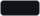 | `#10131a` | `--bg` | page background under the map, before its tiles |
| 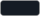 | `#151b24` | `--corner` | the window's rounded corners, outside the frame |
| 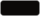 | `#0b0908` | `--ink`, `--ink-raw` | panel glass at 86 % (`--glass`), with no backdrop blur so the twinkle stays cheap |
|  | `#000000` | `#tour .bar` | the tour's cinema bars |

### Map ground

| | Hex | Constant | Use |
|---|---|---|---|
| 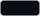 | `#0a0c11` | `GROUND.plane.earth` | land, night view: near black, so dim embers carry |
| 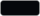 | `#05070b` | `GROUND.plane.water` | lakes and rivers, night view: darker still |
| 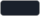 | `#1a202b` | `GROUND.colors.earth` | land, colour map: a lighter slate under the brighter legal-form colours |
| 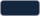 | `#12263d` | `GROUND.colors.water` | lakes and rivers, colour map: deep blue |

### Lamp light (night view and the interface's glow)

| | Hex | Token / constant | Use |
|---|---|---|---|
|  | `#8b574f` | `--ember-raw`, `NIGHT_RGB` | one lamp; stacked lamps add up through orange and cream to white |
| 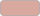 | `#d9a99f` | `--ember`, `--ember-lit-raw`, `NIGHT_UI_RGB` | lit ember: accents, the frame in night view, the tour's progress line |
| 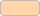 | `#ffd6aa` | `--spark-raw` | the hot core of glows (`--lit`, `--halo`) |
| 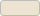 | `#ede3d1` | `--lamp`, `--lamp-raw` | primary text and icons; panel hairlines at 14 % (`--hair`) and 32 % (`--hair-hi`) |
| 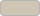 | `#cfc5b4` | `--soft` | secondary text, idle buttons |
| 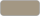 | `#a39783` | `--dim` | muted labels |

Glows are layered `box-shadow` and `text-shadow` stacks: spark at the centre,
ember around it (`--lit`, `--halo`, `--aura`).

Canton tiles glow in ember in proportion to the log of their company count
(`--glow`, 0–1). Background, text and shadow all scale with it. The dimmest
tile still passes WCAG AA.

### Legal forms (colour map and legend)

Alphabetical, on a warm-to-cool spectrum. On the map each colour is scaled by
0.55 (`LAMP_TONE`), so its light sits near the ember's. A point with several
companies takes the colour of its first company in an active form.

| | Hex | Legal form |
|---|---|---|
| 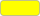 | `#ffff00` | Aktiengesellschaft (AG / SA) |
|  | `#ffd700` | Ausländische Niederlassung (foreign branch) |
|  | `#ffa500` | Besondere Rechtsform (special legal form) |
|  | `#ff8c00` | Einzelunternehmen (sole trader) |
|  | `#ff7f50` | Genossenschaft (cooperative) |
|  | `#ff6347` | GmbH / SARL (LLC) |
|  | `#ff5555` | Haupt von Gemeinderschaften |
|  | `#e63b8b` | Institut des öffentlichen Rechts (public-law institution) |
|  | `#d632ce` | Kollektivgesellschaft (general partnership) |
|  | `#c620bf` | Kommanditgesellschaft (limited partnership) |
|  | `#8b4db8` | Stiftung (foundation) |
|  | `#7b5dab` | Verein (association) |
| 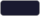 | `#1a1a30` | fallback for a point with no active form (filtered out, never drawn) |

### Timeline

| | Hex | Constant | Use |
|---|---|---|---|
|  | `#ffffff` | shader | opening flare, colour map |
| 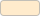 | `#ffebcc` | shader | opening flare, night view (warm white) |
|  | `#ff5028` | `TL_CLOSE_RGB` | closing glow |
|  | `#ff6b4a` | `.tl-close` | the "Closed" count |

### Signals

| | Hex | Where | Use |
|---|---|---|---|
| 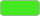 | `#46e821` | `.search-marker` | ring on a search hit, for 3 s: the only green on screen, so it is found at once |
|  | `#c83c3c` | `.load-error` | a canton that failed to load, at 90 % opacity |
|  | `#6c8eff` | `--accent` | the spinner on a loading canton's count: the one cool blue, read as "busy" rather than as data |

Translucent whites (`--border`, `--surface`, `--white-*`) are plain white at
6–60 % and are left out of the swatches.

---

## Layout

- **Desktop.** Cantons on the left, legend and light panel on the right, the
  search bar on top and the timeline along the bottom. Side panels collapse off
  screen, and a collapsed panel is made `inert` so the keyboard skips it.
- **Phone (≤ 980 px).** Panels become bottom sheets, one at a time; the
  company card is one of them. Night view and the timeline sit next to the
  search. The light panel, tilt, names, tour and about buttons gather in a dock
  at the bottom right. Back closes an open sheet.
- **Canton picker.** A tile grid shaped like the map of Switzerland
  (`CANTON_TILES`). Each tile glows by company count. A tap flies the map
  there; every canton stays on.
- **Frame.** A 3 px border round the window, tinted with the average colour of
  the lamps in view. Its bottom corners have a larger radius to sit inside the
  browser window's own rounded corners on macOS.
- **Tour.** Cinema bars crop the frame to 2.39:1 (at most 16 % of the screen
  each), and the interface fades away except for what a scene points at.

---

## Accessibility

- The map is a `main` landmark. Every control has a name, and keyboard focus
  shows a visible ring.
- Legend items are checkboxes (`aria-checked`). Panel toggles report
  `aria-expanded`.
- Filter changes are announced in a live region (`#sr-status`).
- `prefers-reduced-motion` cuts transitions, turns camera flights into jumps
  and stops the twinkle (see EFFECTS.md).
- Escape closes a pinned card, then the sheets, and stops the tour.
