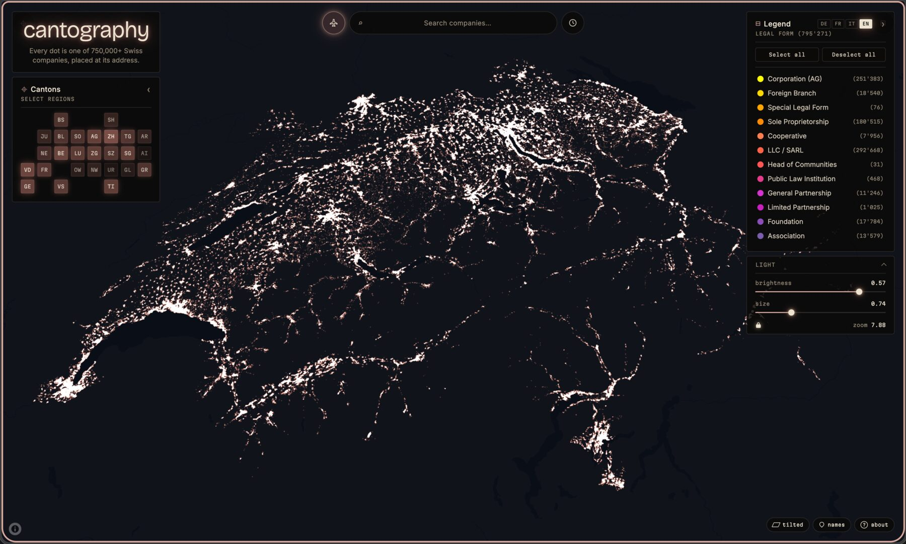
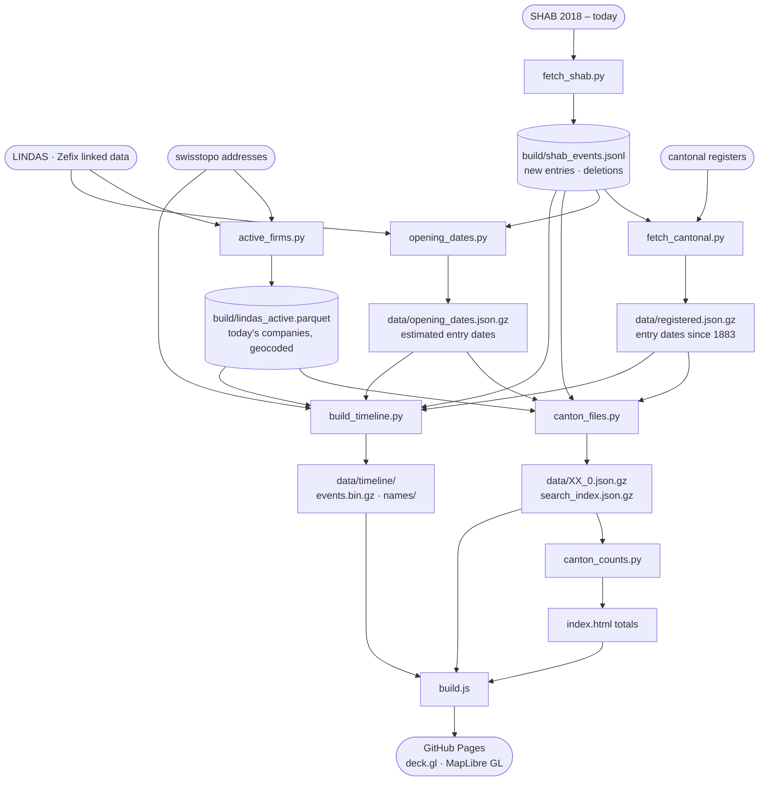

# Cantography

An interactive map of every registered company in Switzerland — all 795,000 of them — and a timeline of how they appeared, from 1883 to today.

---

<p align="center">
  
</p>

---

## What is this?

Cantography turns Switzerland's official public business registry into a visual map you can explore. Each dot on the map is a real, registered company, placed on its building. The colour tells you what kind of company it is — corporations in yellow, foundations in purple, sole traders in orange, and so on.

The **timeline** replays how those companies appeared: every company lights up on the day it entered the commercial register (back to 1883), and every company deleted since 2018 burns out on the day it left.

**Live at → [cantography.ch](https://cantography.ch)**

No account needed. No install. Just open the link.

---

## How to use it

### Navigating the map
- **Scroll** (or pinch on mobile) to zoom in and out
- **Click and drag** to move around
- **Hover any dot** to see the companies at that address — name, legal form and the year it was registered (*'98*); **click** to pin the card so you can select text and open each company in the official register ([Zefix](https://www.zefix.ch)) with the ↗ link. Click empty map or press **Esc** to close it
- **Share what you see**: the address bar keeps the zoom, position, legal-form filters, night view and the timeline's date, so copying the link shares the exact view

### Searching for a company
Type any company name in the **search bar** at the top of the map (or press **/** from anywhere). Results search across all 795,000 companies — even ones whose canton is still loading — ignore accents (*zurich* finds *Zürich*) and list names that start with your text first.

- Use **↑ / ↓ arrow keys** to move through results, **Enter** to select, **Esc** to close
- Click any result to fly directly to that company on the map — a green ring marks the exact dot for 3 seconds, and its card opens with that company on top
- If a company name matches multiple locations (e.g. a chain with branches), all locations are marked and the map fits to show them all
- If the company's canton is still loading, the marks appear as soon as it lands

### Left panel — Cantons
All 26 cantons (regions) are on the map, each drawn as soon as its data arrives. The panel is a map of tiles, brighter where there are more companies: hover a tile to see the canton's total, click it to fly there. If a canton fails to load, a message offers to retry.

### Right panel — Legend
The legend shows the 12 legal forms and their colours. Click any item to hide or show that company type, on the map and in the timeline. The number in brackets shows how many companies of that type are in view; it spins while a canton is still loading.

The interface is in English; switch it to German with **DE** in the top-right of the legend (and back with **EN**). Your choice is remembered.

### Night view
The **moon** button next to the search turns every company into a warm light, like a satellite photo of Switzerland at night: dense business districts glow, single companies twinkle. The exposure adapts to what is in view, so a village is as readable as Zürich. With few legal forms switched on, the lights grow bigger and brighter so the few left stay easy to see.

### Timeline
The **clock** button next to the search opens the timeline at the bottom of the screen.

- **▶ Play** replays company life from 1883 to today. Before 2018 each year passes in a time proportional to its new companies; from 2018 the pace is constant
- A company **flashes white** when it enters the register and **burns out in red** when it is deleted
- The date shows the **year** before 2018 and the **month** from 2018 (when the SHAB, the official gazette, starts recording both entries and deletions)
- The bars show new entries per year before 2018, and new entries (up) and deletions (down) per month after
- Drag the **slider**, or use **← / →**, to move a year at a time before 2018 and a month at a time after; **Space** plays and pauses
- **Opened**, **Closed** and **Net** count the companies of the legal forms you have switched on
- Every light has its legal form's colour and the same brightness; only the twinkle moves it. Companies at one address share one light, as on the map, so lights only add up as you zoom out
- Hover (or tap) a light to see the same card as on the map: the company's name, the year it was registered (*'98*) and its legal form

What the timeline cannot show: companies deleted **before 2018** (no source lists them with an address), and moves before 2018 — a company sits at its current address for its whole life.

### The tour
The **▶ tour** button among the chips at the bottom right plays a ~70 s film of the map that also shows how to use it, with music made in the browser as it plays. The map has the same music under the visitor's own moves, filters and timeline, from the first click or touch: **♪ sound** among the chips (in the dock on phones) or beside **✕ esc** turns it off or on, the choice is kept, and on iPhone the silent switch mutes it; ♪ is hidden where the browser can't play it; **✕ esc** or **Esc** stops the tour and puts the map back the way it was. Open `?tour=1` to start it on its own. The scenes, the music and the link options are in [design/tour.md](design/tour.md).

### On a phone
The search takes the whole top row; night view and timeline stack on the right under the legend button. The panels and the company card open as bottom sheets — tap the corner icons to open them and the map to close them. A pinch on the map zooms the map; elsewhere it zooms the page, for anyone who needs the text larger. On desktop, the **‹** and **›** arrows in each panel header slide it out of the way.

---

## Where does the data come from?

Company data comes from Switzerland's official open sources:

- **LINDAS** — the commercial register (Zefix) as linked data: every company that exists today, with its name, legal form and address
- **swisstopo** — the federal register of building addresses, which places each company on its building
- **SHAB / FOSC / FUSC** — the Swiss Official Gazette of Commerce: every new entry and deletion since 2018, with its date and address
- **The cantonal commercial registers** — the excerpt of each company carries its entry date, back to 1883

The map tiles (the street map underneath) come from [OpenFreeMap](https://openfreemap.org/) using [OpenStreetMap](https://www.openstreetmap.org/) data — both fully open-source, with no API key and no rate limits.

**No data is collected from visitors.** There is no tracking, no cookies, no login.

---

## Technical notes

For those curious about how it works under the hood. How it looks, moves and sounds is in [design/](design/README.md): every colour in [look.md](design/look.md), the motion, sizes and timings in [motion.md](design/motion.md), the music and sounds in [sound.md](design/sound.md), the tour scene by scene in [tour.md](design/tour.md).

- **One list of today's companies** feeds both views: `scripts/canton_files.py` writes the 26 canton files and the search index from LINDAS, so at the end of the timeline every lit lamp sits on a map point
- **Entry year** (the *'98*): the cantonal register's date, else the SHAB new entry, else an estimate from the order of the register ids (`scripts/opening_dates.py`); known for 99.99% of companies
- The canton files are gzipped columnar JSON (~12 MB for all 26), fetched on demand — no server needed. All 26 start loading alongside the map style and each is drawn as it lands, so nothing waits on data before the first paint
- Fetching, unzipping and grouping a canton by address run in a **web worker**, which hands the points back as typed arrays (transferred, not copied) and the names as one string, so a canton loads without blocking the page
- Canton and legal-form filters run on the GPU (deck.gl `DataFilterExtension`), on the map and the timeline alike, so toggling them never re-uploads the points
- A separate **search index** (`search_index.json.gz`, ~9 MB) is downloaded, accent-folded and queried in a second web worker, so searching 795,000 names never blocks the map
- The **night view** is a custom deck.gl layer: additive blending, auto exposure from the lamps in view and a per-lamp twinkle in the shader
- The **timeline** (`data/timeline/`) has one lamp per company life, 1,049,000 in all. `events.bin.gz` (3.9 MB) holds, per lamp, its position on a uint16 grid (3–5 m) along a Morton curve, delta-coded and split into byte planes, its entry and deletion days, legal form and canton. The shader works out from the screen clock whether each lamp is dark, flashing, lit or burning out, so a frame only changes one uniform. Names come in 65 regional chunks of ~180 kB, fetched on the first hover over their region
- A **service worker** caches the data files after the first visit; each rebuild bumps their version
- The layout adapts to phones (bottom sheets, notch and home-bar safe areas, `100dvh`, 16px inputs so iOS does not zoom on focus; the page can still be zoomed, as WCAG 1.4.4 asks)
- The map renders entirely in your browser using [deck.gl](https://deck.gl) and [MapLibre GL](https://maplibre.org/). `bun run build` bundles just the deck.gl classes the page uses into `vendor/deck.mjs` (223 kB gzipped, against 575 kB for the full build) and copies MapLibre into `vendor/maplibre/`, so the map loads from the site itself, not a CDN; run it once before serving the source folder
- Built toward WCAG 2.1 AA and checked with axe-core in Chrome and Firefox: keyboard navigation throughout (shut panels and the hidden interface during the tour are out of the tab order), ARIA names and live regions, panel text at AA contrast, the page zoomable.; a phone's sheet opened from the keyboard takes the focus, and Windows high contrast keeps the on/off states
- The data files are gzip written by [zopfli](https://github.com/google/zopfli) (`scripts/zopfli_data.py`): the same format the browser already unzips, ~6% smaller than `gzip -9`. The deploy ships only what the page fetches
- The whole thing is a single HTML file + data files, minified by `scripts/build.js` and hosted for free on GitHub Pages at [cantography.ch](https://cantography.ch) (formerly SwissViz)

### Data pipeline



To refresh the data, from the repo root:

```sh
python3 scripts/active_firms.py          # today's companies (LINDAS + swisstopo)
python3 scripts/fetch_shab.py            # new SHAB publications (appends, skips known ids)
python3 scripts/fetch_cantonal.py --parquet   # cantonal cache -> data/registered.json.gz
python3 scripts/canton_files.py          # canton files + search index
python3 scripts/canton_counts.py         # totals in index.html
python3 scripts/build_timeline.py        # timeline (bump TL_VERSION in index.html)
uv run --with zopfli python scripts/zopfli_data.py   # recompress what the page fetches, ~6% smaller
```

---

Built by [ExtraPolo.com](https://extrapolo.com) · Data: [LINDAS](https://lindas.admin.ch) · [SHAB](https://www.shab.ch) · cantonal commercial registers · [swisstopo](https://www.swisstopo.admin.ch) · Map: [OpenFreeMap](https://openfreemap.org/) / [OpenStreetMap](https://www.openstreetmap.org/)
